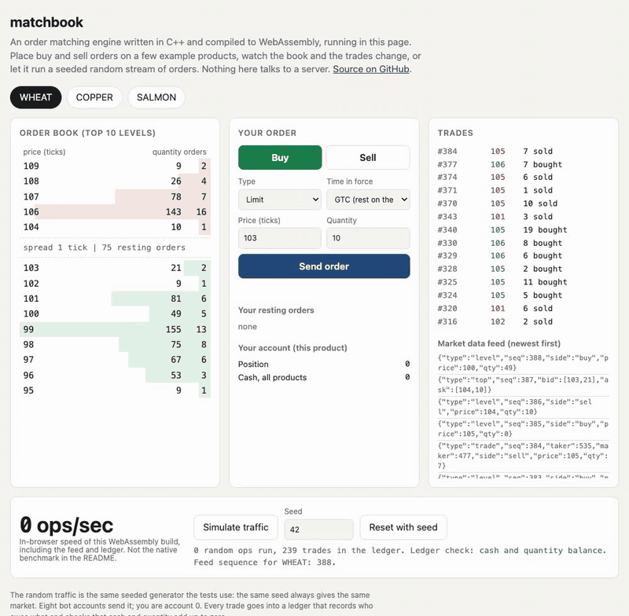
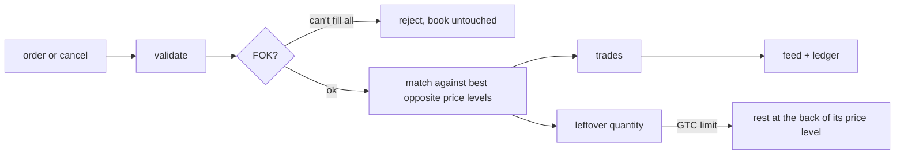

# matchbook

[](https://github.com/andyhetianjun/matchbook/actions/workflows/ci.yml)

**Try it in your browser: https://andyhetianjun.github.io/matchbook/** (the engine compiled to WebAssembly; no server)



To try the command line version locally, run `scripts/try.sh`. It builds the tool and runs the example orders below.
(CMake 3.21+ and a C++20 compiler needed. No CMake? `CMAKE="uvx cmake" scripts/try.sh` fetches one with uv.)

I built a matching engine, the part of an exchange that pairs buy orders with sell orders, because I'm
taking CS 246 (C++ and object-oriented design) this term and wanted to see how far careful data structure
choices go on a problem where speed matters. It is written in C++20 and comes with tests, sanitizer builds
and a benchmark.

A few words first:

- **Order book**: the list of orders waiting to trade. Buyers say the highest price they will pay, sellers
  say the lowest they will accept. A trade happens when a buy and a sell overlap.
- **Price-time priority**: the fairness rule for who trades first. Better prices go first, and among orders
  at the same price, the one that arrived earlier goes first.
- **IOC (immediate or cancel)**: trade whatever you can right now and throw away the rest.
- **FOK (fill or kill)**: trade the whole amount right now, or do nothing at all.

It supports limit and market orders (a market order takes whatever price is available), cancel and modify,
partial fills, IOC and FOK, trade events, and best bid/ask and depth snapshots. Prices and quantities are
integers (ticks), never floats. My approach: get the matching rules right first, check them against a slow
reference, then measure and speed up one thing.

## Features

- [Many products, a market data feed, and a settlement ledger](docs/multi-instrument-market.md): one order book per
  product, a numbered feed of trades and price level changes that a late joiner can rebuild the book from, and a ledger
  that records who owes what and checks that cash and quantity balance.
- [WebSocket gateway](docs/gateway.md): send orders and receive the feed over a WebSocket, with an integration test.
- [Browser demo](docs/browser-demo.md): the whole engine compiled to WebAssembly, with a page to place orders, watch
  the book and run seeded random traffic.

## Run it

You need CMake 3.21+ and a C++20 compiler (I used Apple clang 21; the code also builds clean with GCC 16).
GoogleTest is downloaded by CMake the first time you configure.

```sh
cmake --preset release
cmake --build --preset release -j
ctest --preset release                    # unit tests + randomized comparison
./build/release/matchbook --book 3 data/example.csv
./build/release/matchbook_bench           # throughput and latency
```

Sanitizer build (AddressSanitizer + UBSan), which CI also runs:

```sh
cmake --preset sanitize && cmake --build --preset sanitize -j && ctest --preset sanitize
```

## Command line tool

`matchbook [--book [N]] [orders.csv]` reads commands from a file (or stdin) and prints trades.
One command per line, columns `action,id,side,type,tif,price,qty`. Unused columns stay empty.

```
NEW,1,BUY,LIMIT,GTC,100,10
NEW,2,SELL,MARKET,IOC,,5
CANCEL,1
MODIFY,1,,,,101,8
```

Lines starting with `#` and a header row are skipped. Output is one `TRADE,taker,maker,side,price,qty`
line per trade and a `REJECT,id,reason` line for anything refused. Bad input lines are reported on stderr
with their line number. `--book N` prints the top N levels per side at the end.

`data/example.csv` is a short walk through the features. Running it gives:

```
$ ./build/release/matchbook --book 3 data/example.csv
TRADE,6,2,BUY,101,3
TRADE,6,3,BUY,101,2
TRADE,7,3,BUY,101,2
TRADE,7,1,BUY,102,5
TRADE,9,4,SELL,100,4
REJECT,42,UnknownId
BOOK
  ---
  BID 100 x 6 (1 orders)
12 commands, 5 trades, 1 rejects, 0 bad lines
```

## Rules

- Price-time priority: best price first, and within a price the oldest order first.
- A trade happens at the resting (maker) order's price.
- GTC limit: match what crosses, rest the remainder.
- IOC: match what crosses, drop the remainder.
- FOK: if the whole quantity cannot be filled right now at the limit price or better, do nothing at all.
  This is checked before anything is touched, so a killed FOK never changes the book.
- Market orders never rest. GTC on a market order behaves like IOC. Market FOK works like any FOK.
- Modify: lowering the quantity at the same price keeps the queue position. Any other change (more
  quantity, a different price) is a cancel plus a new order, so it goes to the back of the queue and can
  trade if the new price crosses.
- Rejected: quantity <= 0, limit price <= 0, an id that is already resting (for new orders), an unknown id
  (for modify). An id can be reused once the old order is filled or cancelled.
- There is no self-trade prevention, because orders have no owner field.

## How it works



The same thing in more detail:

```
                 submit(order)
                      |
         validate -> FOK check (read only) -> match against best opposite levels
                                                   |            |
                                               trades[]    leftover qty
                                                                |
                                      GTC limit: rest at the back of its level

  bids: std::map<price, Level> (highest first)      asks: std::map<price, Level> (lowest first)
        Level { head, tail, total qty, count }            |
             head -> [order] <-> [order] <-> [order] <- tail      (intrusive FIFO, by index)

  nodes_: one std::vector<Node> pool, free slots chained through `next`
  index_: unordered_map<OrderId, slot>      cancel(id): index -> node -> level, unlink, done
```

Design choices, briefly:

- **Price levels in a `std::map`.** The best price is `begin()`, and level counts are small, so a
  balanced tree is simple and fast enough. A flat array indexed by tick would be quicker when the
  price range is bounded, but I did not want to hard-code a range.
- **Orders in a pool, linked by index.** Each resting order is a `Node` in one `std::vector`. Nodes point
  at their neighbours with 32-bit indices, and freed nodes go on a free list, so the steady state does no
  allocation per order. Indices (not pointers) survive the vector growing. `OrderBook(reserve)` allocates
  up front if you know the size.
- **Cancel is O(1) work, with one caveat.** The id index gives the node, the node holds a pointer to its
  level, and unlinking from a doubly linked list is constant time. The one extra cost is when the cancel
  empties a price level: the level is then erased from the map, which is O(log levels).
- **Level totals are kept up to date**, so depth snapshots and the FOK check read one number per level
  instead of walking queues.
- **`validate()`** walks every structure (links, totals, counts, index, pool free list, book not crossed)
  and returns a description of the first problem. The tests call it after every operation.

## Testing

`ctest --preset release` runs 78 tests, all passing on my machine (also with the sanitizer preset). 51 cover the
single book, listed below; the other 27 cover the exchange, feed, ledger and text protocol and are described in
[docs/multi-instrument-market.md](docs/multi-instrument-market.md). The gateway has its own test, run with `npm test`.

- Matching edge cases: price and time priority, partial fills on both sides, sweeping several levels,
  trading at the maker's price, market orders on an empty book, IOC and FOK (exactly enough, not enough,
  liquidity only beyond the limit), duplicate ids, bad quantities and prices.
- Cancels at the head, middle and tail of a queue, cancelling something already filled, modify cases.
- Pool churn (many add/fill/cancel rounds) to catch leaked or double-freed slots.
- **Randomized comparison**: `tests/reference_book.hpp` is a deliberately slow book (flat vector, scanned
  on every operation, shares no code with the real one). `tests/random_test.cpp` sends the same random
  operations to both and compares the result, the trades, best bid/ask, the full depth and individual
  orders after every step, plus `validate()`. It runs 45 seeded streams of 3000 to 4000 operations and
  one 40000-operation stream, using narrow price ranges so that crossings are frequent, and a tiny id
  space in one case so that duplicate ids and stale cancels are common.
- The CSV parser and replay.

Compiler flags are `-Wall -Wextra -Werror` on our own code. The format is checked by `clang-format` in CI
(`.clang-format` is in the repo).

## Benchmark

`bench/replay_bench.cpp` generates a seeded stream of operations and replays it through the book. Mix:
62% passive limit orders, 13% crossing limit orders, 8% IOC, 2% market, 1% FOK, 10% cancels of recent ids,
4% modifies. The mid price drifts a tick now and then. With the default stream (2,000,000 operations,
seed 42) it produces about 854,000 trades, and the book ends with about 641,000 resting orders over about
200 price levels. That is a deep book, which stresses memory more than a typical liquid market would.

```sh
cmake --preset release && cmake --build --preset release -j
./build/release/matchbook_bench --ops 2000000 --seed 42 --runs 5
```

Throughput times the whole replay with no clock calls inside the loop and reports the median of the runs.
Latency times each operation separately with `steady_clock`.

Measured on: Apple M5 Pro (15 cores), macOS 27.0, Apple clang 21.0.0, Release (`-O3`, from CMake's
default Release flags). The machine was busy with other work during these runs (load average around 18),
so treat the numbers as rough.

| | throughput (median) | p50 | p90 | p99 | p99.9 |
|---|---|---|---|---|---|
| current | about 13.3 M ops/sec | 42 ns | 166 ns | 500 ns | 875 ns |

The latency numbers include the cost of the timer. On this machine the timer appears to tick every 42 ns, so
anything below that reads as 42 ns: p50 is really "under one tick" and I would not read more into it. The
benchmark prints a measured clock overhead line too. The slowest single operation is in the milliseconds,
which I put down to the OS and the machine being busy, not the book.

### One optimization, before and after

The first version stored each price level as a `std::list` (one heap allocation per resting order) and
the id index pointed at list iterators. Cancelling looked up the level in the map again by price. I
replaced that with the pool and intrusive index-linked list described above, and made each node hold a
pointer to its level so cancel skips the map lookup. The first version is tagged `baseline-list-orders`
and `scripts/compare_bench.sh` builds both and runs them alternately, so they see the same machine load:

```sh
PAIRS=7 ./scripts/compare_bench.sh
```

Seven alternating pairs on the same stream (each line is the median of 5 replays):

| | throughput, median of 7 (range) | p90 | p99 |
|---|---|---|---|
| before (`std::list`) | 9.74 M ops/sec (8.90 to 9.89) | 208 ns | 625 ns |
| after (pool) | 13.31 M ops/sec (12.08 to 13.91) | 166 ns | 500 ns |

About 1.37 times the throughput and a lower tail. Both versions produce identical trade counts and final
books on this stream (854,179 trades, 641,422 resting orders), and both pass the same tests. I did not
separate how much of the gain comes from skipping per-order allocation and how much from skipping the
map lookup on cancel. An earlier set of runs on a busier machine gave a wider spread (before 5.9 to 10.0 M,
after 5.1 to 13.4 M ops/sec), which is why I used alternating runs and the median.

## Layout

```
include/matchbook/types.hpp        orders, trades, results
include/matchbook/order_book.hpp   the book
src/order_book.cpp
include/matchbook/csv_replay.hpp   CSV parsing and replay (used by the CLI)
src/csv_replay.cpp
include/matchbook/exchange.hpp     many books, ownership, feed and ledger together
include/matchbook/feed.hpp         feed messages, snapshots, and a client-side book mirror
include/matchbook/ledger.hpp       who owes what, and the balance check
include/matchbook/traffic.hpp      seeded random order stream
include/matchbook/wire.hpp         text requests in, JSON lines out
cli/main.cpp                       command line tool
cli/market_main.cpp                the exchange as a process (the gateway runs this)
gateway/                           WebSocket gateway (Node) and its integration test
wasm/api.cpp, web/index.html       WebAssembly entry points and the demo page
scripts/build_wasm.sh              builds the demo into site/
bench/replay_bench.cpp             seeded stream + throughput/latency
bench/market_bench.cpp             the same for the whole exchange
tests/                             unit tests, reference book, randomized test
scripts/compare_bench.sh           before/after benchmark
data/example.csv
```

## What I'd do next

- Try a flat array of levels indexed by tick, with a bitmap to find the best price, and measure it
  against the `std::map`.
- Replace `std::unordered_map` for the id index with an open-addressing table. It is probably the next
  biggest cost, but I have not measured it yet.
- Add owner ids and self-trade prevention, and stop orders.
- Check the benchmark again on a quiet machine, and add a benchmark where the book stays shallow.
- Fuzz the CSV parser.

## License

MIT
