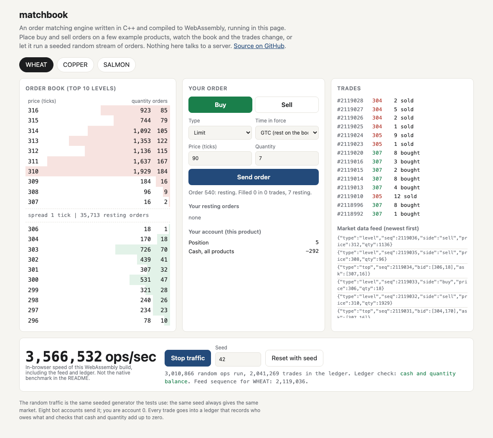

# Browser demo (WebAssembly)

The exchange compiled to WebAssembly so you can try it in a web page, with no server: **https://andyhetianjun.github.io/matchbook/**



## Why I added this

I wanted something anyone could try in ten seconds without installing a compiler. I also wanted to see how much of a C++
project carries over to the browser unchanged. Here it was all of it: the same source files as the command line tool
and the tests are compiled with Emscripten, and one small file (`wasm/api.cpp`) exposes a handful of C functions.

## What you can do

- Pick one of three example products (WHEAT, COPPER, SALMON; made-up names with prices in whole ticks).
- Place a buy or sell order, limit or market, with GTC, IOC or FOK, and watch the book depth, the trades and the raw
  market data feed messages update. Click a price in the book to fill it into the form. Cancel your resting orders.
- Press **Simulate traffic** to run a seeded random stream of orders from eight bot accounts. A running **ops/sec** counter
  shows how fast the engine is going in your browser. The same seed always gives the same market, and **Reset with seed** starts over.
- The line under the controls shows the ledger check: every trade is in the ledger, and cash and quantity must balance.

## About the ops/sec number

It is the speed of this WebAssembly build inside your browser, while it also publishes the feed and records the ledger.
The page times only the engine call (not the drawing) and reports operations divided by that time over the last second and a half.
It is not the native benchmark from the README, which uses a bare order book on the command line, and it depends on your
browser and computer.

Measured with `scripts/build_wasm.sh`, a local static server, and headless Chrome on the same Apple M5 Pro (three runs,
a second or two of traffic each): between 3.0 and 3.6 million operations per second. For comparison, the native build of the same
exchange does about 4.4 million operations per second on that machine (`matchbook_market_bench`, see
`docs/multi-instrument-market.md`), so the WebAssembly build ran at roughly three quarters of native speed here. These are single
unrepeated runs on a busy machine, so treat them as rough.

## How to build it

```sh
brew install emscripten            # or install the emsdk
scripts/build_wasm.sh              # writes site/index.html, site/matchbook.js, site/matchbook.wasm
python3 -m http.server -d site 8000   # then open http://localhost:8000/  (stop it with Ctrl-C when done)
```

The `pages` GitHub Actions workflow (`.github/workflows/pages.yml`) runs the same script with an Emscripten setup
action and publishes `site/` on each push to main. All paths on the page are relative, so it works under the
`/matchbook/` address that GitHub Pages uses.

## How it works

`wasm/api.cpp` exports four functions: `mb_init(seed)`, `mb_command(line)`, `mb_traffic(ops)` and `mb_state(product)`.
`mb_command` takes the same text request lines as the command line tool and the gateway (`include/matchbook/wire.hpp`),
so a typed order in the page goes through the same code as one from a WebSocket. `mb_traffic` runs the seeded generator
from `src/traffic.cpp` without encoding any JSON, so the speed counter is not dominated by string building. `mb_state`
returns a JSON summary that the page draws.

During simulation the page calls `mb_traffic` in batches, adjusting the batch size to take about 10 ms of engine time per
animation frame, so the page stays responsive.

## Limits

- The books only show the top 10 price levels.
- The ledger in the page keeps its last 20,000 entries (the balances are always complete).
- I checked it in headless Chromium. I have not tested other browsers or phones.
